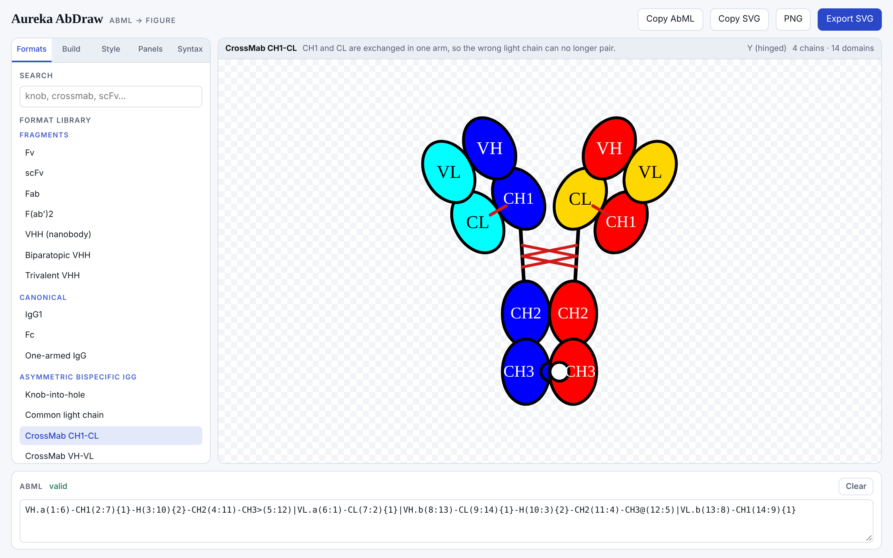
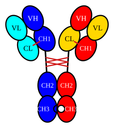
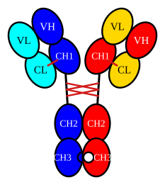
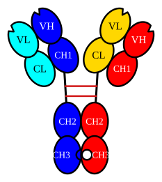

# Aureka AbDraw

**Draw multispecific antibody format schematics from one line of text.**

AbDraw reads [AbML](docs/abml.md) — a compact notation for antibody architecture — and renders
the molecule as a domain schematic that exports to clean, editable SVG. 43 formats ship in the
library, from a bare Fv to trispecific knob-into-hole constructs.

[**Open the tool**](https://drjackxiaoyuchen.github.io/aureka-abdraw/app/) ·
[**Browse the gallery**](https://drjackxiaoyuchen.github.io/aureka-abdraw/gallery/) ·
[**AbML reference**](docs/abml.md)



---

## Why

Drawing an IgG is easy. Drawing a CrossMab so a reader can see *which* domains crossed is not —
and that is exactly the figure a bispecific paper needs.

AbDraw colours each domain by **where it came from**, not which chain it currently sits on. When
VH/VL or CH1/CL are exchanged, the colour travels with the domain, so the three CrossMab variants
are visually distinct without a caption:

| CrossMab CH1-CL | CrossMab VH-VL | CrossMab Fab |
|---|---|---|
|  |  |  |

## Quick start

Pick a format from the library, or type AbML directly:

```
VH.a-CH1-H-CH2-CH3 | VL.a-CL
```

That draws a Fab arm on an Fc stem. Add identifiers to declare which domains pair, braces for the
disulfides between them, and modification symbols for engineered interfaces:

```
VH.a(1:6)-CH1(2:7){1}-H(3:10){2}-CH2(4:11)-CH3>(5:12)
| VL.a(6:1)-CL(7:2){1}
| VH.b(8:13)-CH1(9:14){1}-H(10:3){2}-CH2(11:4)-CH3@(12:5)
| VL.b(13:8)-CL(14:9){1}
```

`>` and `@` are the knob and the hole. Full grammar in [docs/abml.md](docs/abml.md), and the same
reference is built into the tool under its **Syntax** tab.

## Features

- **Live parse and render** — the figure follows the text as you type, with parse errors listed rather than swallowed.
- **43-format library** in eight families, each one a starting point you can modify.
- **Structured builder** — assemble chains from dropdowns and let the tool write the AbML; `Renumber & auto-pair` fixes up identifiers and interactions from the architecture.
- **Panel figures** — stack several formats into a lettered A/B/C grid and export the comparison as one SVG.
- **SVG and PNG export**, plus copy-to-clipboard for both the AbML and the SVG markup.
- **Deep links** — every format has a URL, e.g. `app/#crossmab-ch1-cl`.
- **Aureka figure conventions** — Times New Roman labels, transparent ground, and a palette built on the Blues/Reds/Greys ramps, all overridable.

## Running it

| How | What to do |
|---|---|
| Hosted | [drjackxiaoyuchen.github.io/aureka-abdraw](https://drjackxiaoyuchen.github.io/aureka-abdraw/) |
| Offline | Download [`app/index.html`](app/index.html) and open it. One file, no build step, no dependencies, no network. |
| As data | [`formats.json`](formats.json) carries every format as name, category, description and AbML string. |

## Format library

### Fragments

| Format | Description |
|---|---|
| [Fv](https://drjackxiaoyuchen.github.io/aureka-abdraw/app/#fv) | The minimal antigen-binding unit: a VH–VL heterodimer with no constant domains. |
| [scFv](https://drjackxiaoyuchen.github.io/aureka-abdraw/app/#scfv) | VH and VL carried on one polypeptide and held together by a flexible linker. |
| [Fab](https://drjackxiaoyuchen.github.io/aureka-abdraw/app/#fab) | Heavy-chain Fd (VH–CH1) disulfide-bonded to a complete light chain. |
| [F(ab')2](https://drjackxiaoyuchen.github.io/aureka-abdraw/app/#f-ab-2) | Two Fab arms held together by the hinge disulfides, with no Fc. |
| [VHH (nanobody)](https://drjackxiaoyuchen.github.io/aureka-abdraw/app/#vhh-nanobody) | A single camelid heavy-chain variable domain that binds without a light chain. |
| [Biparatopic VHH](https://drjackxiaoyuchen.github.io/aureka-abdraw/app/#biparatopic-vhh) | Two VHH domains in tandem, each raised against a different epitope on one target. |
| [Trivalent VHH](https://drjackxiaoyuchen.github.io/aureka-abdraw/app/#trivalent-vhh) | Three linked VHH domains giving three binding specificities on one short chain. |

### Canonical

| Format | Description |
|---|---|
| [IgG1](https://drjackxiaoyuchen.github.io/aureka-abdraw/app/#igg1) | The parental monospecific, bivalent antibody that every format below modifies. |
| [Fc](https://drjackxiaoyuchen.github.io/aureka-abdraw/app/#fc) | The hinge–CH2–CH3 homodimer on its own, the effector and half-life module. |
| [One-armed IgG](https://drjackxiaoyuchen.github.io/aureka-abdraw/app/#one-armed-igg) | Monovalent IgG: one Fab arm, a bare knob-into-hole Fc on the other side. |

### Asymmetric bispecific IgG

| Format | Description |
|---|---|
| [Knob-into-hole](https://drjackxiaoyuchen.github.io/aureka-abdraw/app/#knob-into-hole) | Reciprocal CH3 steric mutations drive heterodimerisation of two different heavy chains. |
| [Common light chain](https://drjackxiaoyuchen.github.io/aureka-abdraw/app/#common-light-chain) | Both arms share one light chain, so only heavy-chain pairing has to be engineered. |
| [CrossMab CH1-CL](https://drjackxiaoyuchen.github.io/aureka-abdraw/app/#crossmab-ch1-cl) | CH1 and CL are exchanged in one arm, so the wrong light chain can no longer pair. |
| [CrossMab VH-VL](https://drjackxiaoyuchen.github.io/aureka-abdraw/app/#crossmab-vh-vl) | VH and VL are exchanged in one arm, keeping the constant-domain interface untouched. |
| [CrossMab Fab](https://drjackxiaoyuchen.github.io/aureka-abdraw/app/#crossmab-fab) | The whole Fab is swapped in one arm — both the variable and the constant pair cross over. |
| [Orthogonal Fab](https://drjackxiaoyuchen.github.io/aureka-abdraw/app/#orthogonal-fab) | Complementary charge and steric mutations across both Fab interfaces enforce correct pairing. |
| [Charge-pair bispecific](https://drjackxiaoyuchen.github.io/aureka-abdraw/app/#charge-pair-bispecific) | Electrostatic steering: opposing charges at the CH3 and CH1/CL interfaces instead of knobs. |
| [DuetMab](https://drjackxiaoyuchen.github.io/aureka-abdraw/app/#duetmab) | Knob-into-hole plus an engineered CH1–CL disulfide replacing the native one in one arm. |
| [kappa-lambda body](https://drjackxiaoyuchen.github.io/aureka-abdraw/app/#kappa-lambda-body) | One common heavy chain pairs with a kappa and a lambda light chain, giving two specificities. |

### Appended IgG

| Format | Description |
|---|---|
| [DVD-Ig](https://drjackxiaoyuchen.github.io/aureka-abdraw/app/#dvd-ig) | A second variable domain stacked N-terminal to each native one: tetravalent and bispecific. |
| [IgG-scFv (heavy C-term)](https://drjackxiaoyuchen.github.io/aureka-abdraw/app/#igg-scfv-heavy-c-term) | An scFv fused to each heavy-chain C-terminus — tetravalent, bispecific, symmetric. |
| [IgG-scFv (light C-term)](https://drjackxiaoyuchen.github.io/aureka-abdraw/app/#igg-scfv-light-c-term) | The same idea with the scFv hung off each light-chain C-terminus instead. |
| [scFv-IgG (heavy N-term)](https://drjackxiaoyuchen.github.io/aureka-abdraw/app/#scfv-igg-heavy-n-term) | An scFv placed ahead of each VH, so the second specificity sits at the tip of the arm. |
| [IgG-VHH](https://drjackxiaoyuchen.github.io/aureka-abdraw/app/#igg-vhh) | A single VHH domain on each heavy-chain C-terminus — the smallest symmetric append. |
| [Two-in-one Fab (DAF)](https://drjackxiaoyuchen.github.io/aureka-abdraw/app/#two-in-one-fab-daf) | One paratope engineered to bind two antigens, so the molecule stays a plain IgG. |
| [ADC (site-specific)](https://drjackxiaoyuchen.github.io/aureka-abdraw/app/#adc-site-specific) | An IgG carrying defined conjugation sites for a cytotoxic payload. |

### Fragment bispecifics

| Format | Description |
|---|---|
| [BiTE (tandem scFv)](https://drjackxiaoyuchen.github.io/aureka-abdraw/app/#bite-tandem-scfv) | Two scFvs in tandem on one chain — the T-cell engager archetype, no Fc at all. |
| [Diabody](https://drjackxiaoyuchen.github.io/aureka-abdraw/app/#diabody) | Linkers too short to fold back, so two chains cross-pair into a compact bivalent dimer. |
| [scDiabody](https://drjackxiaoyuchen.github.io/aureka-abdraw/app/#scdiabody) | The diabody folded onto a single chain by adding a third, longer middle linker. |
| [DART](https://drjackxiaoyuchen.github.io/aureka-abdraw/app/#dart) | A diabody locked by an added C-terminal interchain disulfide for stability. |
| [TandAb](https://drjackxiaoyuchen.github.io/aureka-abdraw/app/#tandab) | Two identical four-domain chains dimerise head-to-tail into a tetravalent bispecific. |
| [Triplebody](https://drjackxiaoyuchen.github.io/aureka-abdraw/app/#triplebody) | Three scFvs in a row on one chain, giving three specificities without an Fc. |

### Fc fusions

| Format | Description |
|---|---|
| [scFv-Fc](https://drjackxiaoyuchen.github.io/aureka-abdraw/app/#scfv-fc) | An scFv on each side of an Fc: bivalent, monospecific, roughly half the mass of an IgG. |
| [VHH-Fc (HCAb)](https://drjackxiaoyuchen.github.io/aureka-abdraw/app/#vhh-fc-hcab) | Camelid-style heavy-chain-only antibody: one VHH per chain, straight onto the hinge. |
| [Bispecific VHH-Fc](https://drjackxiaoyuchen.github.io/aureka-abdraw/app/#bispecific-vhh-fc) | Two different VHH domains on a knob-into-hole Fc — the compact asymmetric bispecific. |
| [Tandem scFv-Fc](https://drjackxiaoyuchen.github.io/aureka-abdraw/app/#tandem-scfv-fc) | Two tandem scFvs per chain on an Fc: tetravalent and bispecific, fully symmetric. |
| [Diabody-Fc](https://drjackxiaoyuchen.github.io/aureka-abdraw/app/#diabody-fc) | A diabody grafted onto an Fc, which restores long serum half-life. |
| [Receptor-Fc trap](https://drjackxiaoyuchen.github.io/aureka-abdraw/app/#receptor-fc-trap) | A soluble receptor ectodomain on an Fc, used to soak up a ligand. |
| [Zipper-assembled bispecific](https://drjackxiaoyuchen.github.io/aureka-abdraw/app/#zipper-assembled-bispecific) | A leucine zipper on each C-terminus forces the two different half-antibodies together. |

### Trispecific

| Format | Description |
|---|---|
| [Trispecific IgG-scFv](https://drjackxiaoyuchen.github.io/aureka-abdraw/app/#trispecific-igg-scfv) | A knob-into-hole bispecific with a third specificity appended as an scFv on one chain. |
| [Trispecific VHH-Fc](https://drjackxiaoyuchen.github.io/aureka-abdraw/app/#trispecific-vhh-fc) | Three VHH domains distributed across a knob-into-hole Fc. |

### Receptors

| Format | Description |
|---|---|
| [TCR alpha-beta](https://drjackxiaoyuchen.github.io/aureka-abdraw/app/#tcr-alpha-beta) | The alpha/beta T-cell receptor ectodomain pair. |
| [TCR gamma-delta](https://drjackxiaoyuchen.github.io/aureka-abdraw/app/#tcr-gamma-delta) | The gamma/delta T-cell receptor ectodomain pair. |

## Repository layout

```
index.html              landing page (generated)
app/index.html          the tool — single self-contained file
gallery/index.html      rendered gallery (generated)
formats.json            the format library as data
assets/svg/             one pre-rendered SVG per format (generated)
docs/abml.md            AbML reference
tools/build_formats.py  generates formats.json from scaffold builders
tools/build_site.py     generates index.html and gallery/
tools/render_gallery.js generates assets/svg/
```

Regenerate everything after editing `tools/build_formats.py`:

```bash
python3 tools/build_formats.py formats.json
node    tools/render_gallery.js     # needs playwright
python3 tools/build_site.py
```

## Limits

- AbML in, figure out. There is no free-form drag canvas and no inference of AbML from a drawing — use the **Build** tab instead.
- Asymmetric constructs with more than four chains lay out legibly but may not match a hand-drawn cartoon.
- AbML describes architecture, not sequence. Residue-level annotation is out of scope.

## Credits

The AbML notation is from:

> Sweet-Jones J, Ahmad M, Martin ACR. *Antibody markup language (AbML) — a notation language for
> antibody-based drug formats and software for creating and rendering AbML (abYdraw).*
> **mAbs** 14:1 (2022). doi:[10.1080/19420862.2022.2101183](https://doi.org/10.1080/19420862.2022.2101183)

Please cite that paper if you use AbDraw in published work.

This project is an independent implementation and shares no code with the reference tool,
[abYdraw](https://github.com/JamesSweetJones/abYdraw) (GPL-3.0). See [NOTICE.md](NOTICE.md) for detail
on how the format library was produced.

## License

MIT — see [LICENSE](LICENSE).
